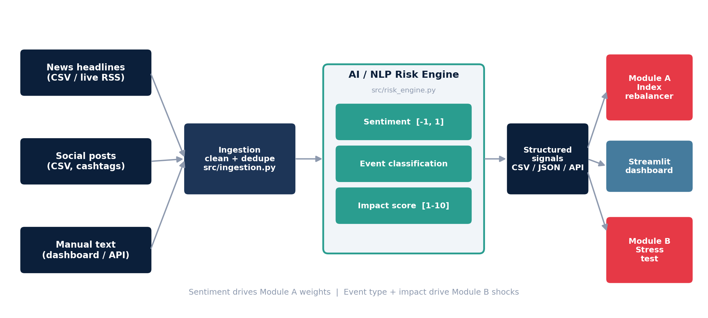

# RiskPulse AI - S&P Global & Crisil Campus Hackathon

- **Candidate Name:** Deepali Kumari
- **College Email ID:** deepali.24bce11526@vitbhopal.ac.in
- **College / Campus:** VIT Bhopal University
- **Demo Video Link:** [add your unlisted YouTube link here]
- **Slide Deck:** [`docs/presentation.pdf`](docs/presentation.pdf)

## 1. Project Overview / Problem Statement & Approach

Risk-relevant information reaches a bank as unstructured text: news headlines, social posts, analyst
chatter. RiskPulse AI reads that text and converts it into machine-readable risk signals: a **sentiment
score** (-1 to 1), an **event classification** (9 classes, e.g. Geopolitical, Credit Event) and an
**impact score** (1-10), along with the company/ticker involved and the words that drove the result.
Signals are available as CSV/JSON, through a small FastAPI service, and in a dashboard.

Two downstream modules consume those signals. **Module A** is a tactical index rebalancer: a mock
15-stock index shifts weight toward stocks with improving sentiment and away from those with
deteriorating sentiment, with the effect decaying over time. **Module B** is a strategic stress tester:
when an event's impact crosses a threshold, event-specific shocks are applied to a synthetic
$105M wholesale-banking book (equities, bonds, loans, derivatives) and the before/after value is shown.

## 2. Architecture & Tech Stack



- **Python 3.10+**, **pandas / NumPy** for data and portfolio maths
- **Rule-based NLP engine** (lexicon with negation + intensifiers, keyword event classifier, impact heuristic)
- **Streamlit + Plotly** dashboard, **FastAPI** service, **pytest** test suite
- **feedparser** for optional live RSS headlines

Layout: `src/` (engine, ingestion, rebalancer, stress test, evaluation) · `app.py` (dashboard) ·
`api.py` (HTTP API) · `data/` · `tests/` · `docs/`. More detail in [`docs/architecture.md`](docs/architecture.md).

## 3. Dataset Used

All data is synthetic; nothing confidential or proprietary is used.

| File | What it is |
|---|---|
| `data/news_headlines.csv` | 50 synthetic news-style headlines (source 1) |
| `data/social_posts.csv` | 62 synthetic microblog-style posts with cashtags (source 2) |
| `data/companies.csv` | 15 **fictional** companies/tickers forming the mock index |
| `data/synthetic_portfolio.csv` | 8-line synthetic portfolio: equity, bonds, loans, derivatives |
| `data/labeled_eval.csv` | 63 hand-labelled headlines used to evaluate the engine |
| `data/sample_risk_signals.json` | example engine output |

`scripts/make_sample_data.py` regenerates the news/social files (fixed seed). Live public RSS
headlines can be switched on in the sidebar; availability depends on the feeds.

**Assumptions:** Fictional companies are used on purpose so no invented news is attached to real
firms. The story arcs (e.g. Northstar Bank trending negative) are built into the generator to make
the rebalancer's behaviour visible. Shock sizes are illustrative, not calibrated to history.

## 4. Quickstart & Installation

Runtime: Python 3.10+ (developed on Python 3.12, Linux).

```bash
git clone https://github.com/<your-username>/vitbhopal-deepali-kumari-hackathon.git
cd vitbhopal-deepali-kumari-hackathon
python -m venv .venv
source .venv/bin/activate          # Windows: .venv\Scripts\activate
pip install -r requirements.txt
streamlit run app.py               # dashboard at http://localhost:8501
```

Other commands:

```bash
python -m src.pipeline             # write outputs/risk_signals.csv and .json
uvicorn api:app --reload           # API at http://127.0.0.1:8000/docs
python -m src.evaluate             # accuracy vs. labelled set
python -m pytest -q                # test suite
```

## 5. Key Results & Domain Impact

**Engine evaluation** (63 hand-labelled headlines, `python -m src.evaluate`):

| Task | Accuracy | Macro-F1 | Majority-class baseline |
|---|---|---|---|
| Sentiment (Pos/Neg/Neutral) | 60.3% | 0.60 | 42.9% |
| Event type (9 classes) | 84.1% | 0.86 | 17.5% |

Event classification is strong; sentiment is clearly better than naive but is the weakest part
(it misses phrases like "tensions ease"). This is the first thing a
finance-tuned transformer would replace.

**What the prototype shows**
- Two sources → one structured signal table (CSV/JSON/API).
- Module A: index weights move with sentiment, stay within 2%-15% caps, and fade with a half-life.
- Module B: a credit event at impact 8 costs the synthetic book about 10%; a geopolitical event about 8%.
  Government bonds can *gain* in a geopolitical shock because rates fall, which the duration-based model captures.

**Why it matters:** analysts and risk teams cannot read everything. Turning text into a traceable
signal that feeds both a fast tactical view (index weights) and a slower strategic view (stress losses)
shortens the path from "something happened" to "what does it do to our book".

## 6. Limitations & Next Steps

- Sentiment is a lexicon baseline, not a trained model; the evaluation set is small and hand-labelled.
- Impact is a heuristic, not calibrated to market returns.
- Stress shocks are simplified (no correlations, liquidity, recovery rates, or derivative Greeks).
- No real X/Twitter data (API access is paid); social posts are synthetic.
- Next: finance-tuned transformer (e.g. FinBERT), larger labelled set, historical backtests, streaming ingestion.

## 7. AI Assistance Disclosure

I used an AI assistant (Claude, by Anthropic) while building this project, as the hackathon
guidelines allow. I started with my own Phase 3 starter prototype (a basic risk engine,
stress test and Streamlit dashboard). The AI assistant then helped me extend it: it
reviewed the starter, added the index rebalancer (Module A), the FastAPI service,
the evaluation set and the tests, corrected the stress-test maths, and helped
draft the slides and documentation.

My own contribution: I chose the project direction and scope, ran the dashboard,
API and test suite on my machine to verify they work, reviewed the code and outputs,
and prepared the demo and submission. I am able to explain the design choices
(sentiment scoring, impact heuristic, rebalancer decay and caps, duration-based stress shocks)
and I have noted the limitations of the project in Section 6.

All bundled data is synthetic and was generated for this project. This is an educational
prototype and not financial advice.
