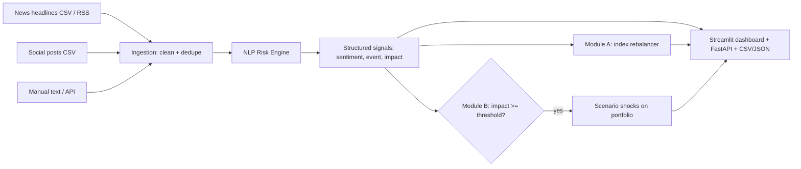

# Architecture

## Flow
1. `src/ingestion.py` loads the news and social sources (and optionally live RSS), strips URLs and
   duplicates.
2. `src/risk_engine.py` scores each text: sentiment in [-1, 1], one of 9 event labels, an impact
   score from 1 to 10, plus the company/ticker and the words that drove the score.
3. `src/pipeline.py` writes the signals to `outputs/risk_signals.{csv,json}`; `api.py` serves them.
4. `src/rebalancer.py` (Module A) turns sentiment into index weights over time.
5. `src/stress_test.py` (Module B) fires a shock scenario when impact crosses the threshold.
6. `app.py` ties it together in one dashboard.

## Design choices
- **Rules first.** A lexicon + rules engine runs offline, is easy to explain line by line, and
  gives a baseline to measure a future transformer against (`src/evaluate.py`).
- **Decay in the rebalancer.** Old news should matter less, so each stock's sentiment state decays
  with a configurable half-life, and weights are capped to avoid concentration.
- **Duration-based shocks.** Bonds and loans are shocked through duration / spread duration rather
  than a flat percentage, so long-duration assets react more to rate moves.
